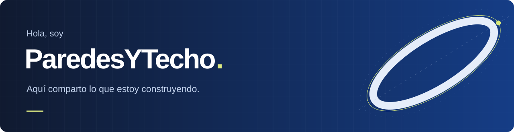

Me gusta entender cómo funcionan las cosas y probar mis propias ideas. Ahora estoy dando forma a **Cerith** y mantengo **SkullBoard** y **Werewolf**, dos proyectos que nacieron alrededor de comunidades de Discord.

Me interesan los sistemas, el desarrollo de software y las herramientas de IA. Aquí voy compartiendo mis proyectos y las decisiones que tomo mientras los hago evolucionar.

## En lo que estoy trabajando

### [Cerith](https://github.com/ParedesYTecho/Cerith)

Estoy reuniendo métricas de hardware, rendimiento en videojuegos y uso de herramientas de IA en una aplicación nativa para Windows. Quiero poder elegir qué información veo y cómo la organizo, sin depender de varias aplicaciones.

**C# · .NET · WinUI 3 · PresentMon**  
Prototipo funcional en fase alfa. Los componentes visuales siguen en desarrollo; todavía no hay instalador público ni versión estable.

[Explorar el código](https://github.com/ParedesYTecho/Cerith) &nbsp; ↗ &nbsp; [Ver el roadmap](https://github.com/ParedesYTecho/Cerith/blob/main/docs/ROADMAP.md)

 

<table>
<tr>
<td width="50%" valign="top">
<h3>💀 SkullBoard</h3>

Quería que los mensajes más graciosos de una comunidad no se perdieran en el chat. Con SkullBoard, las reacciones 💀 deciden cuáles pasan al tablón de destacados.

El proyecto incluye rankings, estadísticas y un dashboard con ajustes por servidor. Sigo mejorando el bot y el panel.

Python · discord.py · Flask · PostgreSQL · JavaScript

<a href="https://github.com/ParedesYTecho/Skullboard"><b>Conocer SkullBoard ↗</b></a> &nbsp; <a href="https://skullboard.vercel.app/">Web ↗</a>

</td>
<td width="50%" valign="top">
<h3>🌙 Werewolf</h3>

Con Werewolf llevo Pueblo Duerme a Discord: roles ocultos, noches, debate y votaciones, con el bot encargado de conducir la partida.

Trabajo también en su panel web, desde el que se gestionan servidores y se consultan perfiles e historial de partidas.

Python · discord.py · Next.js · React · PostgreSQL

<a href="https://github.com/ParedesYTecho/Werewolf"><b>Conocer Werewolf ↗</b></a> &nbsp; <a href="https://werewolfdashboard.vercel.app/">Web ↗</a>

</td>
</tr>
</table>

Los repositorios públicos de SkullBoard y Werewolf presentan los productos y su documentación. Mantengo el código del bot y del dashboard de cada uno en repositorios privados.
